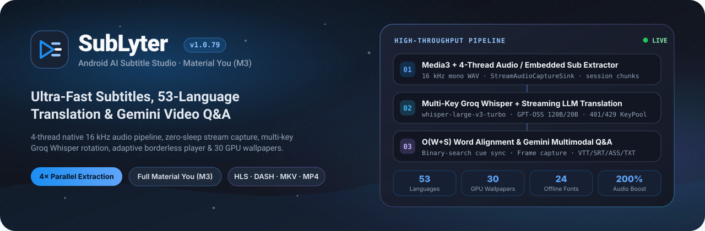
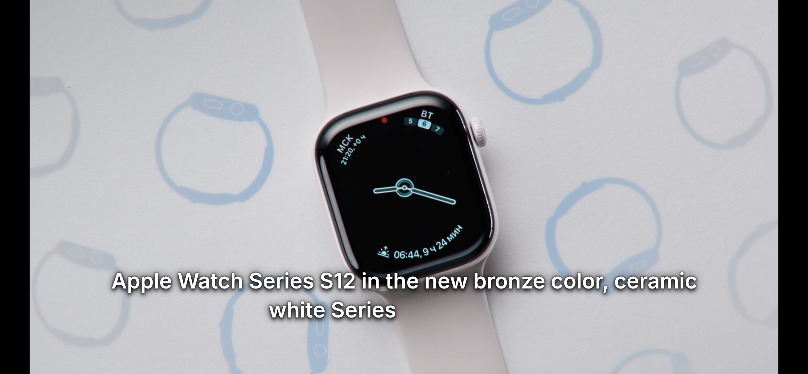
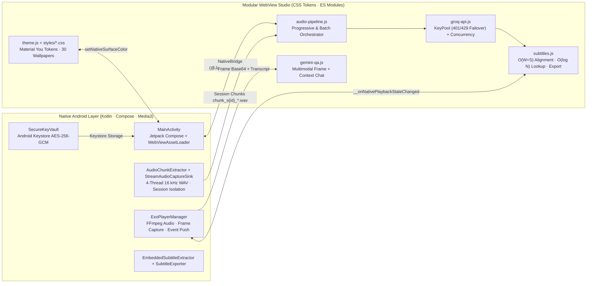

<div align="center">

<p>
  <strong>English</strong> · <a href="README.ru.md">Русский</a>
</p>


<h1>SubLyter</h1>

<p>
  <strong>Ultra-fast AI subtitle studio, 53-language streaming translator, and multimodal Gemini video Q&amp;A player for Android — crafted with a deep, borderless Material You (Material 3) interface.</strong>
</p>

<p>
  <a href="https://github.com/yusibov2026-hue/SubLater/releases/latest">
    
  </a>
  
  
  
  
</p>

<p>
  <a href="https://github.com/yusibov2026-hue/SubLater/releases/latest"><strong>⬇️ Download Latest APK</strong></a> •
  <a href="#-screenshots"><strong>📸 Screenshots</strong></a> •
  <a href="#-why-generation-is-so-fast"><strong>⚡ Speed Engine</strong></a> •
  <a href="#-rich-material-you-m3-design"><strong>🎨 Material You UI</strong></a> •
  <a href="#-architecture--security"><strong>🛡️ Architecture</strong></a> •
  <a href="#-quick-start--building"><strong>🛠️ Build &amp; Tests</strong></a>
</p>

<br />



</div>

---

## ✨ What Is SubLyter?

**SubLyter** (`com.fromsub.app`) turns any local video or network media stream (`MP4`, `MKV`, `HLS .m3u8`, `DASH .mpd`, Stremio/Nuvio intents) into word-synchronized, translated subtitles in seconds — then lets you watch in an adaptive borderless player and ask questions about the video using multimodal Gemini AI.

Unlike simple subtitle wrappers, SubLyter pairs a **native multi-threaded Android Media3 extraction engine** with a **full-featured Material You (Material 3) experience** — complete with dynamic Dark/Light/Auto native system integration, 12 accent color palettes, 30 GPU-accelerated live wallpapers, and 24 offline fonts.

---

## 📸 Screenshots

<div align="center">
<table>
  <tr>
    <td align="center" width="33%">
      <br />
      <sub><strong>Main Studio &amp; Snowfall</strong><br/>Clean borderless controls &amp; Whisper model selector</sub>
    </td>
    <td align="center" width="33%">
      <br />
      <sub><strong>Live Audio Extraction &amp; Player</strong><br/>Watch immediately while chunks stream in</sub>
    </td>
    <td align="center" width="33%">
      <br />
      <sub><strong>Borderless Fullscreen Playback</strong><br/>Crisp live subtitles with adaptive aspect ratio</sub>
    </td>
  </tr>
  <tr>
    <td align="center" colspan="3">
      <table>
        <tr>
          <td align="center" width="50%">
            <br />
            <sub><strong>Material You Customization</strong><br/>Accent colors, 5 surface themes, 30 live wallpapers &amp; fonts</sub>
          </td>
          <td align="center" width="50%">
            <br />
            <sub><strong>AI Engine &amp; Multi-Key Pool</strong><br/>Unlimited Groq keys, Gemini Q&amp;A, 16 kHz fast mode &amp; import</sub>
          </td>
        </tr>
      </table>
    </td>
  </tr>
</table>
</div>

---

## ⚡ Why Generation Is So Fast

SubLyter is engineered end-to-end to minimize waiting time from tap to first subtitle:

| Optimization Layer | How It Works |
| :--- | :--- |
| **4-Thread Native Audio Extraction** | `AudioChunkExtractor.kt` splits local videos into dynamic time windows and decodes them across up to **4 parallel `MediaExtractor` + `MediaCodec` threads** directly to **16 kHz mono PCM16 WAV** — no heavy shell `ffmpeg` spawning overhead. |
| **Zero-Sleep Stream Capture** | For network streams (HLS `.m3u8`, DASH `.mpd`, HTTP/HTTPS from Stremio/Nuvio), a custom Media3 `AudioSink` (`StreamAudioCaptureSink.kt`) decodes packets at **maximum CPU throughput** rather than 1× real-time playback speed. |
| **Progressive Live Streaming** | In **Progressive** mode, you do not wait for the entire movie to finish: chunks are transcribed, translated, and injected into the active player chunk-by-chunk while you watch. **All at once** mode uses dynamic 45–180s parallel windows for rapid batch generation. |
| **Multi-Key Groq `KeyPool` + 4× Concurrency** | Paste multiple Groq API keys (`gsk_...`) to multiply throughput. `runWithConcurrency(..., 4)` uploads and translates up to 4 chunks simultaneously, rotating keys round-robin, automatically switching immediately on HTTP `429` rate limits, and permanently failing over on HTTP `401` rejected keys. |
| **Fast Streamed Translation Pipeline** | Subtitle chunks are streamed directly into LLM translation (`openai/gpt-oss-120b` with `reasoning_effort: low`, `openai/gpt-oss-20b` fast, or `qwen/qwen3.6-27b`) across **53 target languages** as soon as transcription completes. |
| **Instant Embedded Sub Extraction** | Before hitting cloud APIs, `EmbeddedSubtitleExtractor.kt` probes containers for built-in SRT/VTT/ASS tracks. |
| **Zero-Copy HTTP Chunk Server** | Generated WAV files are streamed natively from app cache via WebView `WebResourceRequest` interception with HTTP `200`/`206` responses instead of slow Base64 IPC copies on large files. |
| **O(W + S) / O(log N) Rendering** | Two-pointer word-to-segment alignment and binary-search active cue lookup keep subtitle rendering smooth at **60–144 Hz** even on 2-hour movies. |

---

## 🎨 Rich Material You (M3) Design

SubLyter is **not** a bare dark form — it implements an authentic, deeply customizable **Material You (Material 3)** design system across both WebView and native Android Compose surfaces:

- **True App-Wide Theme Sync (`Dark` · `Light` · `Auto`)** — Automatically follows Android system night mode or manual override, updating CSS tonal tokens (`styles/tokens.css`), Jetpack Compose root background color (`hostSurfaceColorState`), and system status/navigation bar icon contrast (`WindowInsetsController`).
- **12 Tonal Accent Presets + Custom Picker** — Includes Indigo, Sky Blue, Mint, Peach, Rose, Violet, monochrome Pure White (`#ffffff`), and arbitrary hex color selection with luminance-aware on-accent contrast.
- **5 Tonal Surface Backgrounds** — Switch seamlessly between **Dark Gray**, **Gray**, **Light Slate**, **Warm Gray**, and **Graphite**.
- **30 GPU-Accelerated Animated & Procedural Wallpapers** — Choose **Snowfall** (78 stratified `translate3d` snowflakes without dead zones), **Aurora (Glow)**, **Cosmic Nebula**, **Neon Mesh**, **Plasma**, **Sunset**, **Ocean**, **Sound Waves**, **Neon Hexagons**, **Bokeh**, **Cyber Grid**, **Digital Matrix**, **Dot Matrix**, **Concentric Ripples**, **Stardust**, **Tech Circuit**, **Geometric Prisms**, **Checkerboard**, **Light Beams**, **Diagonal Stripes**, **Gray Tiles (Blur)**, **Galaxy**, **Lava**, **Rain**, **Silk Waves**, **Triangles**, **Night Skyline**, **Confetti**, **Vortex**, **Fireflies**, or **No Wallpaper (Solid)**.
  - Syncs wallpaper hue to your active Material You accent color, supports custom brightness scaling, and pauses GPU animations automatically while modals/fullscreen are open.
- **24 Offline-Bundled Title Fonts** — Choose from 24 `.woff2` typefaces (`Plus Jakarta Sans`, `Outfit`, `DM Sans`, `Syne`, `Space Grotesk`, `Unbounded`, etc.) with real-time size slider and preview.
- **Modern M3 Controls** — Borderless cards, pure SVG close buttons, minimalist range sliders without outer rings, animated rotating settings gear, color-coded API key counter badge (`.keys-empty` / `.keys-ready`), and a guided Material You welcome dialog.

---

## 🎬 Adaptive Player, AI Q&A & Studio Tools

### Borderless Adaptive Video Player
- **Media3 ExoPlayer + Software FFmpeg Audio Fallback** — Handles MKV, AC3/EAC3/DTS/FLAC audio tracks, HLS `.m3u8`, and DASH `.mpd` streams natively when browser `<video>` cannot.
- **Zero-Letterbox Aspect Sync** — Automatically adapts container geometry (`syncPlayerAspectRatio`) using `pixelWidthHeightRatio` and `unappliedRotationDegrees` for vertical (`9:16`), square (`1:1`), widescreen (`16:9`), and ultrawide (`21:9`) videos without black bars.
- **Live Word Timing Modes** — Switch between **Word-by-word**, **Karaoke**, and **Full line** animations, plus millisecond **Offset** and **Hold** sliders, **Fit / Fill / Stretch** modes, playback speed control, double-tap seek, and immersive landscape fullscreen.
- **Audio Track Switcher & 200% Boost** — Pick between embedded audio streams (`getAudioTracksJson`) and amplify quiet dialogue up to **200%** via native `LoudnessEnhancer` or Web Audio dynamics compression.
- **Quiet Audio Normalization & Clean Output** — Automatically normalizes low-volume PCM16 WAV chunks (`normalizeWavBlob`), filters Whisper hallucinations (e.g., outro spam), and smartly splits overly long phrases along punctuation/pause boundaries.
- **Export, Import & History** — Export or share subtitles in **`.VTT`**, **`.SRT`**, **`.ASS` (with `\kf` karaoke tags)**, or **`.TXT`**; load existing `.vtt`/`.srt` files; auto-save transcription & playback sessions in `IndexedDB` (with safe resume).

### Multimodal Gemini Video Q&A
- Ask questions about any scene, dialogue, or plot point using **Gemini 4 Hydrogen**, **Gemini 3.8 Flash**, **Gemini 2.5 Flash**, **Gemini 2.5 Pro**, or **Gemini 2.0 Flash**.
- Automatically captures the **current video frame** (`getCurrentFrameBase64` — supporting both local files and `http`/`https` streams) alongside the full timestamped subtitle transcript.
- Generates formatted markdown answers with **clickable `[MM:SS]` timestamp chips** that seek the video directly to the referenced moment.

---

## 🛡️ Architecture & Security

### Native + WebView Pipeline



### Hardening Highlights
- **Hardware-Backed Key Storage** — Groq and Gemini API keys are stored encrypted using `EncryptedSharedPreferences` (`AES256_GCM` / `MasterKey`), initialized off the UI thread with safe fallback.
- **Zero `file://` Origin Exposure** — Assets are served over HTTPS virtual origin via `WebViewAssetLoader`; `allowFileAccessFromFileURLs`, `allowUniversalAccessFromFileURLs`, and mixed content remain disabled.
- **Session-Scoped Cache & Path Traversal Protection** — Audio chunks use `chunk_s{sessionId}_*.wav` naming verified via canonical path prefix checks (`ChunkCachePaths.resolveSafeChunkFile`).
- **Lock-Free Native Audio Callbacks** — `StreamAudioCaptureSink` queues chunk/done/error notifications inside `ioLock` and dispatches them cleanly outside the lock.
- **Production Hardening** — `android:allowBackup="false"`, `network_security_config.xml`, `START_NOT_STICKY` Foreground Service (`SubtitleForegroundService`), R8 minification & resource shrinking for release builds, zero Kotlin compiler warnings, and automatic secret redaction (`gsk_***`, `AIza***`, `Bearer ***`) in `diagnostics.js`.

### Project Layout

```text
app/src/main/
├── java/com/fromsub/app/
│   ├── MainActivity.kt               # Compose host, edge-to-edge bars, WebViewAssetLoader
│   ├── NativeBridge.kt               # Typed @JavascriptInterface bridge
│   ├── ExoPlayerManager.kt           # ExoPlayer, FFmpeg audio, event state push, frame capture
│   ├── AudioChunkExtractor.kt        # Parallel MediaCodec WAV decoder & HTTP chunk server
│   ├── StreamAudioCaptureSink.kt     # Zero-sleep non-real-time AudioSink for streams
│   ├── WavChunkWriter.kt             # PCM16 downmix, resampling & RIFF header writer
│   ├── EmbeddedSubtitleExtractor.kt  # MKV/MP4 internal subtitle track probe
│   ├── SubtitleExporter.kt           # MediaStore Downloads save & FileProvider share
│   ├── SecureKeyVault.kt             # Android Keystore encrypted API key vault
│   └── SubtitleForegroundService.kt  # Extraction foreground notification & cancel hook
└── assets/
    ├── index.html                    # Semantic shell & Material You UI structure
    ├── fonts/                        # 24 bundled .woff2 fonts
    ├── styles/                       # fonts.css · tokens.css · wallpapers.css · player.css · settings.css
    └── js/                           # diagnostics · bridge · storage · subtitles · groq-api ·
                                      # gemini-qa · theme · player · audio-pipeline · app
tests/
├── diagnostics.test.mjs              # Secret redaction & ring-buffer formatting tests
├── groq-api.test.mjs                 # KeyPool rotation, 401/429 failover, WAV normalization tests
├── subtitles.test.mjs                # VTT/SRT/ASS/TXT, O(W+S) alignment & overlap clamping tests
└── gemini-qa.test.mjs                # XSS sanitization & clickable timestamp formatting tests
```

---

## 🚀 Quick Start & Building

### 1. Install on Android
1. Download the latest APK from **[GitHub Releases](https://github.com/yusibov2026-hue/SubLater/releases/latest)**.
2. Open **Settings** (gear icon) and paste one or more **Groq API keys** from [console.groq.com/keys](https://console.groq.com/keys) (one per line or comma-separated).
3. *(Optional)* Add a **Gemini API key** from [aistudio.google.com/apikey](https://aistudio.google.com/apikey) to unlock Multimodal Video Q&A.
4. Pick any video or open a stream externally with **SubLyter**, choose a target translation language (optional), and tap **Create subtitles**.

### 2. Run Automated Tests (Node 18+)
```bash
node --test tests/*.test.mjs
```

### 3. Build from Source
```bash
# Requirements: JDK 17, Android SDK (compileSdk 34, minSdk 24)
./gradlew assembleDebug

# Release build (with R8 minification & resource shrinking enabled)
./gradlew assembleRelease
```

---

## 📄 Notes
- Designed for Android 7.0+ (`minSdk = 24`, `targetSdk = 34`, `package = com.fromsub.app`).
- Need help debugging an edge case? Open **Settings → Generation & Subtitles → Copy log** to copy a redacted diagnostic trace of recent pipeline/player events.
