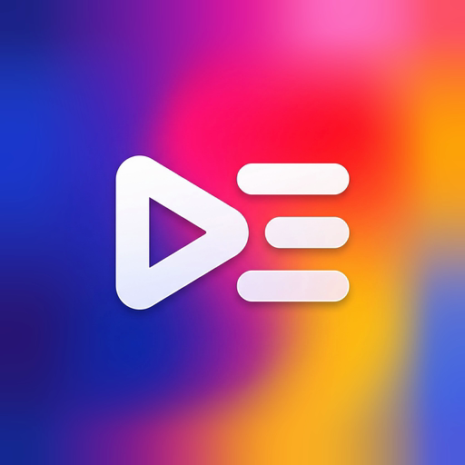
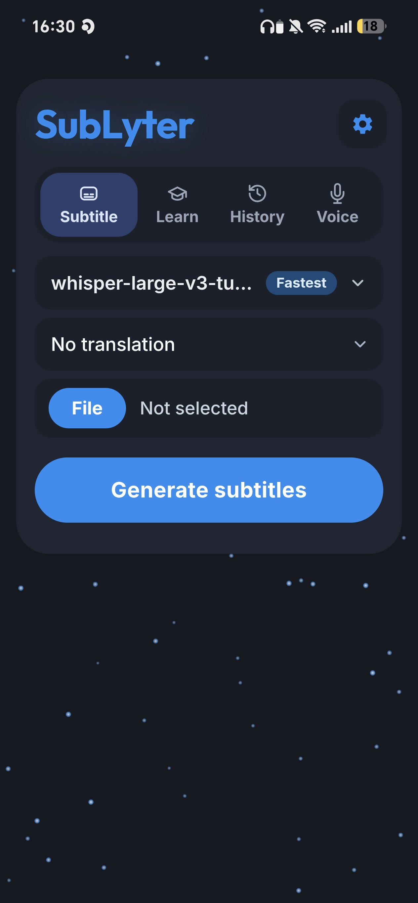
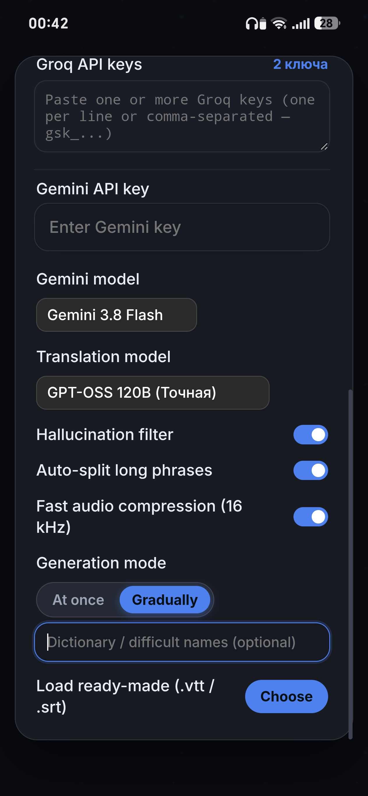
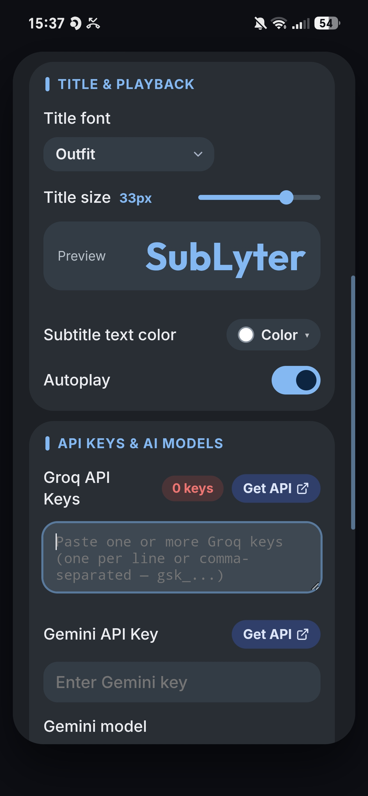
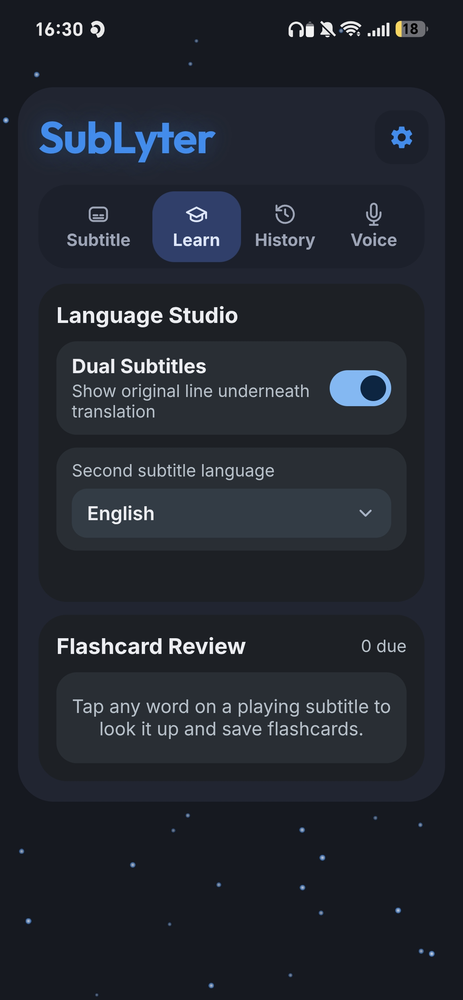
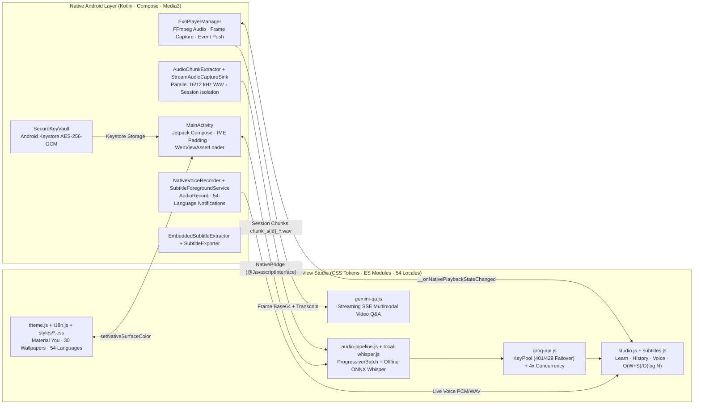

<div align="center">

<p>
  <strong>English</strong> · <a href="README.ru.md">Русский</a>
</p>



<h1>SubLyter</h1>

<p>
  <strong>The one-of-a-kind AI subtitle studio, language learning suite, subtitle archive, and voice-note recorder for Android — uniting <a href="https://groq.com">Groq LPU™</a> hyper-speed cloud AI, downloadable offline ONNX Whisper models, 53-language subtitle translation, a 54-language auto-localized UI, and multimodal Gemini Video Q&amp;A in a borderless Material You (Material 3) studio.</strong>
</p>

<p>
  <a href="https://github.com/yusibov2026-hue/SubLyter/releases/latest">
    
  </a>
  
  
  
  
  
  
</p>

<p>
  <a href="https://github.com/yusibov2026-hue/SubLyter/releases/latest"><strong>⬇️ Download Latest APK</strong></a> •
  <a href="#-why-sublyter-is-one-of-a-kind"><strong>🌟 Unique Features</strong></a> •
  <a href="#-screenshots"><strong>📸 Screenshots</strong></a> •
  <a href="#-why-generation-is-so-fast"><strong>⚡ Speed Engine</strong></a> •
  <a href="#-rich-material-you-m3-design"><strong>🎨 Material You UI</strong></a> •
  <a href="#-architecture--security"><strong>🛡️ Architecture</strong></a> •
  <a href="#-quick-start--building"><strong>🛠️ Build &amp; Tests</strong></a>
</p>

</div>

---

## 🌟 Why SubLyter Is One of a Kind

There is **no other Android app like SubLyter (`com.fromsub.app`)**. Most subtitle players only fetch static subtitle files or lock basic AI behind expensive monthly cloud subscriptions. SubLyter puts an **entire native + AI media studio** directly in your pocket — free, open, hardware-encrypted, and impossibly fast:

1. **Cloud Hyper-Speed (`Groq LPU™`) + Offline Privacy (`ONNX Whisper`)** — Choose between near-instant cloud transcription (`whisper-large-v3-turbo` / `whisper-large-v3`) on **Groq LPU™** hardware, or download **Whisper Base (~76 MB)** and **Whisper Small (~245 MB)** on-device ONNX models (`@huggingface/transformers`) to transcribe 100% offline with zero internet required.
2. **All-in-One 4-Tab Material You Studio Hub** — Smooth shared-axis & full-screen swipe navigation across:
   - **🎬 Subtitle:** Instant word-synchronized subtitles from local videos (`MP4`, `MKV`) or live network streams (`HLS .m3u8`, `DASH .mpd`, Stremio/Nuvio external intents) with 53-language LLM translation.
   - **🎓 Language Studio (Learn):** Turn *any* video into a personal language tutor with **Dual Subtitles** (in any chosen second language), **tap-any-word AI contextual lookup**, and **spaced-repetition flashcards** (`IndexedDB`).
   - **🕘 Subtitle History:** Automatic project archive of every video and subtitle you generate, complete with instant search, language filter chips, `.SRT` export, and one-tap restore directly back into the player.
   - **🎙️ AI Voice Recorder & Notes:** Dedicated native Android `AudioRecord` recorder + audio file importer (`.ogg`, `.opus`, `.m4a`, `.mp3`, `.wav` — great for Telegram/WhatsApp voice notes) powered automatically by `whisper-large-v3-turbo`, extracting clean summaries, transcripts, translations, and searchable action items.
3. **Multimodal Gemini Video Q&A (`Gemini 4 Hydrogen`)** — Chat live with your video inside a streaming YouTube-style AI panel that sees **both the full timestamped transcript and the live captured video frame** (even on network streams), returning clickable `[MM:SS]` jump chips.
4. **Adaptive Borderless Player + Dual Translation Subtitles** — Native Media3 ExoPlayer + software FFmpeg audio fallback, zero-letterbox aspect-ratio lock (`9:16`, `1:1`, `16:9`, `21:9`), **Word-by-word / Karaoke / Full line** subtitle timing, live in-player dual-language track menu (`#subMenu`), and up to **200% LoudnessEnhancer boost**.
5. **54 UI Languages + Auto RTL** — Automatically matches your phone's system locale out of the box (including proper RTL layout for Arabic, Hebrew, Persian, and Urdu) alongside localized Android foreground service notifications.

---

## 📸 Screenshots

<div align="center">
<table>
  <tr>
    <td align="center" width="50%">
      <br />
      <sub><strong>Main Studio &amp; Snowfall Wallpaper</strong><br/>Borderless Material You card, custom Speech Model bottom sheet, translation picker &amp; one-tap subtitle generation</sub>
    </td>
    <td align="center" width="50%">
      <br />
      <sub><strong>Deep Material You (M3) Customization</strong><br/>Dark/Light/Auto appearance, 12-swatch tonal accent grid, 4 background surfaces, 30 GPU wallpapers &amp; opacity slider</sub>
    </td>
  </tr>
  <tr>
    <td align="center" width="50%">
      <br />
      <sub><strong>Typography, Playback &amp; Multi-Key Pool</strong><br/>24 offline title fonts with live preview + multi-key Groq &amp; Gemini vaults with live status badge and <code>Get API</code> shortcuts</sub>
    </td>
    <td align="center" width="50%">
      <br />
      <sub><strong>AI Models, Speed Engine &amp; Diagnostics</strong><br/>Gemini 4 Hydrogen, GPT-OSS 120B, Qwen 3.6 27B, 54 UI languages, Progressive/All at once mode, SRT/VTT import &amp; <code>Copy log</code></sub>
    </td>
  </tr>
  <tr>
    <td align="center" colspan="2">
      <br />
      <sub><strong>Borderless Fullscreen Live Subtitles (Landscape)</strong><br/>Crisp word-by-word &amp; dual subtitle overlay during fullscreen playback without black bars</sub>
    </td>
  </tr>
</table>
</div>

---

## ⚡ Why Generation Is So Fast

> **Powered by Groq LPU™ + Parallel Native Media3 Extraction:** Traditional subtitle apps upload huge raw video files or wait on sluggish GPU queues. SubLyter extracts lightweight mono PCM16 WAV windows locally across up to **4 parallel MediaCodec threads** and fires them through a multi-key **Groq LPU™** round-robin worker pool — delivering word-level timestamps and translations almost instantaneously.

| Optimization Layer | How It Works Under the Hood |
| :--- | :--- |
| **Groq LPU™ Hyper-Speed Inference** | Cloud speech recognition (`whisper-large-v3-turbo` / `whisper-large-v3`) and streaming LLM translation (`openai/gpt-oss-120b`, `openai/gpt-oss-20b`, `qwen/qwen3.6-27b`) run on **Groq LPU™ hardware** with near-zero queue delay. |
| **Offline ONNX Whisper (`Base` &amp; `Small`)** | In-app model picker (`#modelPickerSheet`) downloads quantized ONNX models directly via `@huggingface/transformers`, decodes WAV via `decodeWavToFloat32`, and transcribes 100% locally offline. |
| **Dual Generation Modes (`Progressive` &amp; `All at once`)** | **Progressive** mode transcribes chunk-by-chunk (`16 kHz`) and streams translated lines into the open player immediately while you watch. **All at once** uses a classic **12 kHz mono / 300s (5-min) 4-thread WAV pipeline** with 6s overlap for ultra-fast full-movie batch generation. |
| **Zero-Sleep Stream Capture** | For network streams (`HLS .m3u8`, `DASH .mpd`, HTTP/HTTPS from Stremio/Nuvio), `StreamAudioCaptureSink.kt` captures PCM packets at **full CPU throughput** instead of 1× playback speed. |
| **Multi-Key `KeyPool` + 4× Concurrency** | Paste multiple Groq keys (`gsk_...`) to multiply throughput. `runWithConcurrency(..., 4)` rotates keys round-robin, switches instantly on HTTP `429` rate limits, and fails over cleanly on HTTP `401`. |
| **Instant Embedded Track Probe** | Before using cloud tokens, `EmbeddedSubtitleExtractor.kt` inspects MKV/MP4 containers for existing internal SRT/VTT/ASS tracks. |
| **Zero-Copy HTTP Chunk Server** | Generated WAV files stream straight from app cache via WebView `WebResourceRequest` interception (`HTTP 200`/`206`), avoiding heavy Base64 IPC serialization. |
| **O(W + S) / O(log N) Subtitle Engine** | Two-pointer word-to-segment alignment and binary-search active cue lookup maintain silky-smooth **60–144 Hz** captions even on multi-hour movies. |

---

## 🎨 Rich Material You (M3) Design

SubLyter implements an authentic, deeply cohesive **Material You (Material 3)** design system across both WebView and native Jetpack Compose:

- **Borderless Studio &amp; Expressive Onboarding** — Edge-to-edge borderless main container (`#appTopSection`), translucent M3 welcome tour (`#m3WelcomeModal`), pure SVG close buttons, animated settings gear, and custom Material You bottom sheets (`#modelPickerSheet`, `#subMenu`).
- **True App-Wide Theme Sync (`Dark` · `Light` · `Auto`)** — Automatically tracks Android system dark/light mode, updating all tonal CSS variables (`styles/tokens.css`), Jetpack Compose root canvas (`hostSurfaceColorState`), and system bar icon contrast (`WindowInsetsController`).
- **12 Tonal Accent Presets + Custom Picker** — Choose curated M3 seed swatches (including crisp monochrome White `#ffffff`) or any hex color with automatic luminance-aware `--on-accent` contrast across buttons, badges, and pickers.
- **4 Tonal Surface Themes** — **Dark Gray**, **Gray**, **Light Slate**, and **Warm Gray**.
- **30 GPU-Accelerated Live Wallpapers** — **Snowfall**, **Aurora (Glow)**, **Cosmic Nebula**, **Neon Mesh**, **Plasma**, **Sunset**, **Ocean**, **Sound Waves**, **Neon Hexagons**, **Bokeh**, **Cyber Grid**, **Digital Matrix**, **Dot Matrix**, **Concentric Ripples**, **Stardust**, **Tech Circuit**, **Geometric Prisms**, **Checkerboard**, **Light Beams**, **Diagonal Stripes**, **Gray Tiles (Blur)**, **Galaxy**, **Lava**, **Rain**, **Silk Waves**, **Triangles**, **Night Skyline**, **Confetti**, **Vortex**, **Fireflies**, and **No Wallpaper (Solid)** — hue-synced to your accent and auto-paused during fullscreen/modals.
- **24 Offline Title Fonts** — Bundled `.woff2` typefaces (`Outfit`, `Plus Jakarta Sans`, `DM Sans`, `Syne`, `Space Grotesk`, `Unbounded`, etc.) with live size scaling (`18–38px`).

---

## 🎬 Adaptive Player, AI Video Q&amp;A &amp; Studio Tools

### Borderless Adaptive Video Player
- **Media3 ExoPlayer + Software FFmpeg Audio Fallback** — Plays MKV, AC3/EAC3/DTS/FLAC audio, HLS `.m3u8`, and DASH `.mpd` natively when browser `<video>` lacks codec support.
- **Zero-Letterbox Aspect Sync** — Automatically adjusts geometry (`syncPlayerAspectRatio`) via `pixelWidthHeightRatio` and `unappliedRotationDegrees` for vertical (`9:16`), square (`1:1`), widescreen (`16:9`), and ultrawide (`21:9`) playback.
- **Interactive Dual Subtitles &amp; Learning (`#subMenu` + Learn Tab)** — Toggle dual subtitles right inside the player, pick any second subtitle language on the fly (`translateSegments`), and **tap any subtitle word** to pause, translate in context with AI, and save a spaced-repetition flashcard.
- **Word-by-Word / Karaoke / Full-Line + Offset &amp; Hold** — Millisecond sync tuning, **Fit / Fill / Stretch**, playback speed, double-tap seek, track switcher, **200% LoudnessEnhancer**, quiet WAV normalization, and Whisper hallucination filtering.
- **4 Export Formats + Auto History** — Save or share **`.VTT`**, **`.SRT`**, **`.ASS` (with `\kf` karaoke tags)**, and **`.TXT`**; import existing subtitle files; browse and restore past projects anytime from **Subtitle History**.

### Streaming Multimodal Gemini Video Q&amp;A
- Powered by **Gemini 4 Hydrogen** (with automatic `LOW` thinking config &amp; smart 400 fallback), **Gemini 3.8 Flash**, **Gemini 2.5 Flash**, **Gemini 2.5 Pro**, and **Gemini 2.0 Flash** via live SSE streaming.
- Combines full timestamped subtitle context with **lazy current-frame capture** (`getCurrentFrameBase64`, supporting local files &amp; HTTP/HTTPS streams) whenever visual context is asked, returning clickable **`[MM:SS]` timestamp chips**.

### AI Voice Recorder &amp; Notes (`#hubPanelVoice`)
- Native Android `AudioRecord` voice memo recording (`NativeVoiceRecorder.kt`) plus audio file import (`.ogg`, `.opus`, `.m4a`, `.mp3`, `.wav`).
- Automatically runs `whisper-large-v3-turbo` transcription + optional translation and structured summary/action-item extraction with instant keyword search across all saved notes.

---

## 🛡️ Architecture &amp; Security

### Native + WebView Studio Pipeline



### Engineering &amp; Security Highlights
- **Hardware-Backed Key Vault** — Groq and Gemini API keys are encrypted via `EncryptedSharedPreferences` (`AES256_GCM` / `MasterKey`), initialized off the UI thread.
- **Zero `file://` Exposure** — Local web assets load exclusively via `WebViewAssetLoader` over a virtual HTTPS origin with file/universal access and mixed content disabled.
- **Session Isolation &amp; Path Safety** — Cache files use `chunk_s{sessionId}_*.wav` naming enforced by canonical path prefix verification (`ChunkCachePaths.resolveSafeChunkFile`).
- **Production Hardening** — `android:allowBackup="false"`, `network_security_config.xml`, `START_NOT_STICKY` foreground service, R8 release shrinking (`proguard-rules.pro`), zero Kotlin compiler warnings, and automatic log secret redaction (`gsk_***`, `AIza***`, `Bearer ***`).

### Project Layout

```text
app/src/main/
├── java/com/fromsub/app/
│   ├── MainActivity.kt               # Compose host, IME/edge-to-edge bars, WebViewAssetLoader
│   ├── NativeBridge.kt               # Typed @JavascriptInterface bridge
│   ├── ExoPlayerManager.kt           # ExoPlayer, FFmpeg audio, event state push, frame capture
│   ├── AudioChunkExtractor.kt        # Parallel MediaCodec WAV decoder & HTTP chunk server
│   ├── StreamAudioCaptureSink.kt     # Zero-sleep non-real-time AudioSink for streams
│   ├── WavChunkWriter.kt             # PCM16 downmix, resampling & RIFF header writer
│   ├── NativeVoiceRecorder.kt        # Native AudioRecord voice memo recorder
│   ├── EmbeddedSubtitleExtractor.kt  # MKV/MP4 internal subtitle track probe
│   ├── SubtitleExporter.kt           # MediaStore Downloads save & FileProvider share
│   ├── SecureKeyVault.kt             # Android Keystore encrypted API key vault
│   └── SubtitleForegroundService.kt  # Localized extraction notification & cancel hook
└── assets/
    ├── index.html                    # Semantic shell, Studio Hub & Material You welcome modal
    ├── i18n/                         # 54 complete localization JSON files (incl. RTL languages)
    ├── fonts/                        # 24 bundled .woff2 fonts
    ├── styles/                       # fonts · tokens · wallpapers · player · settings · studio
    └── js/                           # diagnostics · bridge · storage · i18n · subtitles ·
                                      # groq-api · gemini-qa · local-whisper · theme ·
                                      # player · studio · audio-pipeline · app
tests/                                # 7 suites · 32 automated tests
├── diagnostics.test.mjs              # Secret redaction & ring-buffer formatting tests
├── gemini-qa.test.mjs                # XSS sanitization, frame trigger & timestamp tests
├── groq-api.test.mjs                 # KeyPool rotation, 401/429 failover & WAV tests
├── i18n.test.mjs                     # 54-language completeness, RTL & placeholder tests
├── local-whisper.test.mjs            # ONNX Whisper registry, WAV decode & segment tests
├── studio.test.mjs                   # Dual cues, flashcards, history & voice notes tests
└── subtitles.test.mjs                # VTT/SRT/ASS/TXT, O(W+S) alignment & clamping tests
```

---

## 🚀 Quick Start &amp; Building

### 1. Install on Android
1. Download the latest APK from **[GitHub Releases](https://github.com/yusibov2026-hue/SubLyter/releases/latest)**.
2. Open **Settings** (gear icon) and paste one or more **Groq API keys** from [console.groq.com/keys](https://console.groq.com/keys) — or download an **Offline Whisper (`Base` / `Small`)** model in the model picker to run without an API key.
3. *(Optional)* Add a **Gemini API key** from [aistudio.google.com/apikey](https://aistudio.google.com/apikey) to unlock Streaming Multimodal Video Q&amp;A (`Gemini 4 Hydrogen`).
4. Pick a local video, open any stream externally with **SubLyter**, or switch to **Learn / History / Voice** tabs to learn languages or record voice notes.

### 2. Run Automated Tests (Node 18+)
```bash
node --test --test-concurrency=1 tests/*.test.mjs
```

### 3. Build from Source
```bash
# Requirements: JDK 17, Android SDK (compileSdk 34, minSdk 24)
./gradlew assembleDebug

# Release build (with R8 minification & resource shrinking enabled)
./gradlew assembleRelease
```

---

## 📄 Notes
- Designed for Android 7.0+ (`minSdk = 24`, `targetSdk = 34`, `package = com.fromsub.app`).
- Need to inspect a pipeline or playback trace? Open **Settings → Copy log** to copy a redacted diagnostic trace of recent events.
