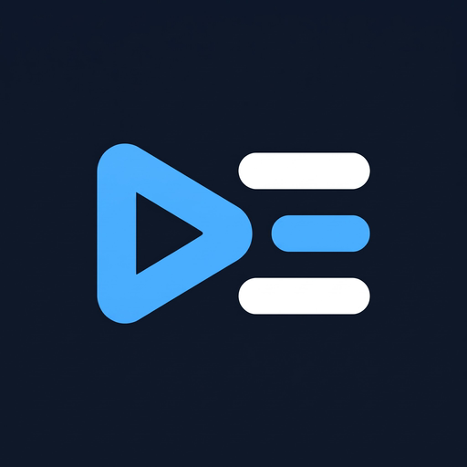
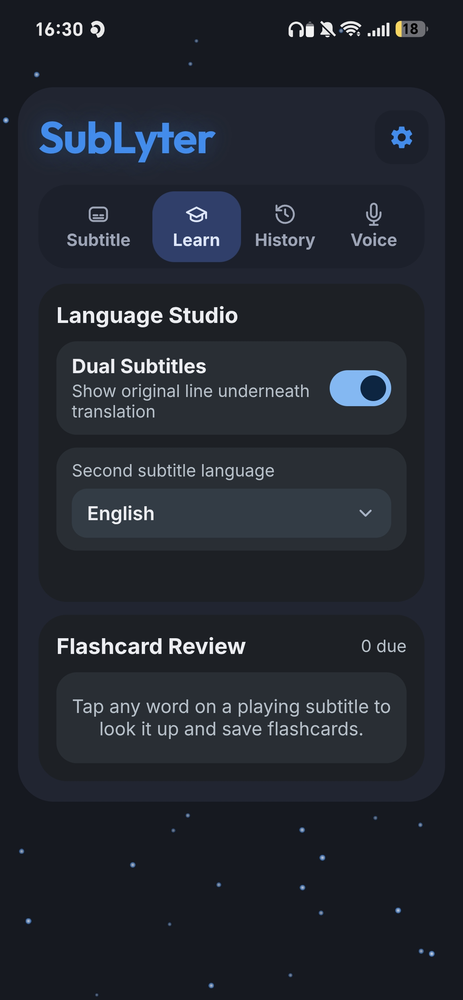
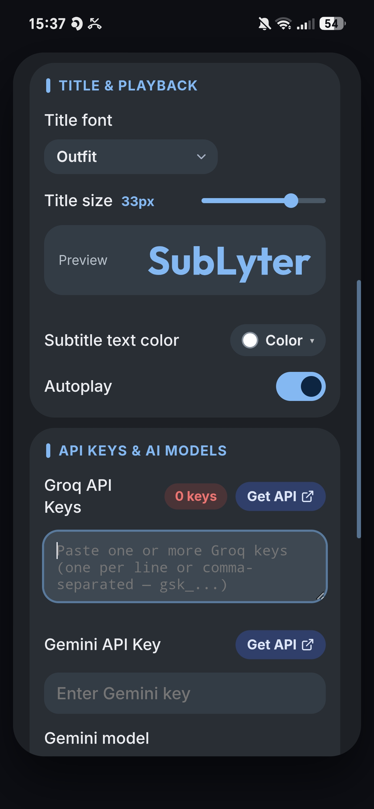
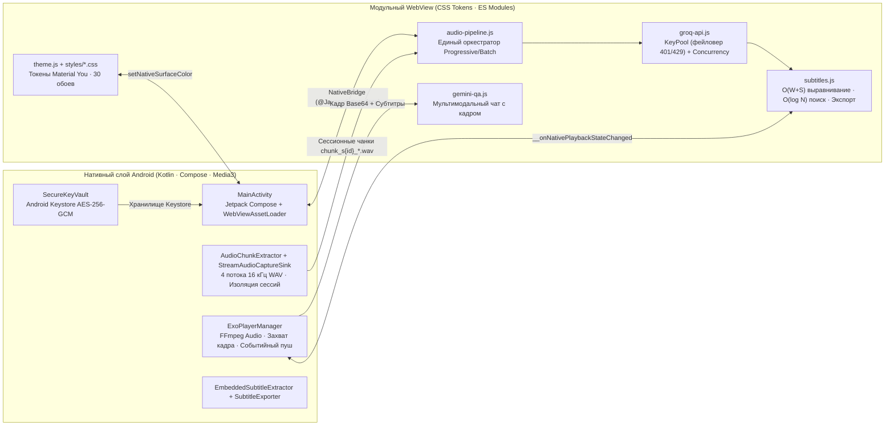

<div align="center">

<p>
  <a href="README.md">English</a> · <strong>Русский</strong>
</p>



<h1>SubLyter</h1>

<p>
  <strong>Сверхбыстрая AI-студия субтитров, потоковый переводчик на 53 языка и мультимодальный видеоплеер с Gemini Q&amp;A для Android — в полноценном безрамочном интерфейсе Material You (Material 3).</strong>
</p>

<p>
  <a href="https://github.com/yusibov2026-hue/SubLater/releases/latest">
    
  </a>
  
  
  
  
</p>

<p>
  <a href="https://github.com/yusibov2026-hue/SubLater/releases/latest"><strong>⬇️ Скачать последний APK</strong></a> •
  <a href="#-скриншоты"><strong>📸 Скриншоты</strong></a> •
  <a href="#-почему-генерация-настолько-быстрая"><strong>⚡ Скорость генерации</strong></a> •
  <a href="#-настоящий-material-you-m3"><strong>🎨 Material You UI</strong></a> •
  <a href="#-архитектура-и-безопасность"><strong>🛡️ Архитектура</strong></a> •
  <a href="#-быстрый-старт-и-сборка"><strong>🛠️ Сборка и тесты</strong></a>
</p>

<br />


</div>

---

## ✨ Что такое SubLyter?

**SubLyter** (`com.fromsub.app`) за считанные секунды превращает любое локальное видео или сетевой поток (`MP4`, `MKV`, `HLS .m3u8`, `DASH .mpd`, внешние ссылки из Stremio/Nuvio) в точные пословные субтитры с переводом на нужный язык, показывает их в адаптивном безрамочном плеере и позволяет задавать вопросы по видео мультимодальному Gemini AI.

В отличие от простых обёрток, SubLyter объединяет **нативный многопоточный аудиодвижок на Media3** и **глубокий, продуманный интерфейс Material You (Material 3)** — с синхронизацией системной светлой/тёмной темы вплоть до нативного Compose-хоста и иконок статус-бара, 12 акцентными палитрами, 30 живыми GPU-обоями и 24 встроенными шрифтами.

---

## 📸 Скриншоты

<div align="center">
<table>
  <tr>
    <td align="center" width="33%">
      <br />
      <sub><strong>Главный экран и «Снегопад»</strong><br/>Безрамочный минимализм и выбор модели Whisper</sub>
    </td>
    <td align="center" width="33%">
      <br />
      <sub><strong>Живое извлечение и плеер</strong><br/>Смотрите видео сразу, пока чанки загружаются</sub>
    </td>
    <td align="center" width="33%">
      <br />
      <sub><strong>Безрамочный Fullscreen</strong><br/>Чёткие пословные субтитры без чёрных полос</sub>
    </td>
  </tr>
  <tr>
    <td align="center" colspan="3">
      <table>
        <tr>
          <td align="center" width="50%">
            <br />
            <sub><strong>Кастомизация Material You</strong><br/>Акценты, 5 фоновых тем, 30 живых обоев и шрифты</sub>
          </td>
          <td align="center" width="50%">
            <br />
            <sub><strong>AI-движок и пул ключей</strong><br/>Несколько ключей Groq, Gemini Q&amp;A, 16 кГц и импорт</sub>
          </td>
        </tr>
      </table>
    </td>
  </tr>
</table>
</div>

---

## ⚡ Почему генерация настолько быстрая

Весь конвейер SubLyter спроектирован с нуля под максимальную скорость от нажатия кнопки до появления первых субтитров:

| Слой оптимизации | Как это работает под капотом |
| :--- | :--- |
| **4-поточное нативное декодирование** | `AudioChunkExtractor.kt` нарезает локальный файл на динамические окна и декодирует до **4 параллельных потоков `MediaExtractor` + `MediaCodec`** напрямую в **16 кГц моно PCM16 WAV** — без медленного запуска консольного `ffmpeg`. |
| **Потоковый захват быстрее реального времени** | Для сетевых потоков (HLS `.m3u8`, DASH `.mpd`, HTTP/HTTPS из Stremio/Nuvio) кастомный Media3 `AudioSink` (`StreamAudioCaptureSink.kt`) разбирает аудиопакеты на **максимальной скорости процессора**, а не со скоростью воспроизведения 1×. |
| **Режим «Gradually / Progressive»** | Не нужно ждать конца фильма: субтитры транскрибируются, переводятся и подставляются в уже открытый плеер чанк за чанком. Режим **All at once** делит аудио на оптимальные окна 45–180 с и обрабатывает всё параллельно. |
| **Пул ключей Groq `KeyPool` + 4 воркера** | Можно вставить сколько угодно ключей Groq (`gsk_...`). `runWithConcurrency(..., 4)` отправляет и переводит до 4 чанков одновременно, распределяя нагрузку round-robin, мгновенно переключая ключ при лимите `429` и отсеивая невалидные ключи при `401`. |
| **Потоковый LLM-перевод на 53 языка** | Как только чанк распознан, он сразу отправляется на перевод (`openai/gpt-oss-120b` с `reasoning_effort: low`, быстрый `openai/gpt-oss-20b` или `qwen/qwen3.6-27b`) без ожидания всего ролика. |
| **Мгновенный поиск встроенных субтитров** | `EmbeddedSubtitleExtractor.kt` проверяет контейнеры MKV/MP4 на готовые внутренние дорожки до обращения к облачным моделям. |
| **Zero-Copy отдача WAV-чанков** | Чанки передаются из кеша через перехват `WebResourceRequest` в WebView (`HTTP 200/206`), минуя тяжёлую передачу огромных Base64-строк через JS-мост. |
| **Алгоритмы O(W + S) и O(log N)** | Выравнивание слов по сегментам за линейное время двумя указателями и бинарный поиск активной реплики обеспечивают плавную отрисовку **60–144 Гц** без фризов даже на длинных фильмах. |

---

## 🎨 Настоящий Material You (M3)

В SubLyter сделана не «простая тёмная тема», а полноценный, живой и безрамочный **Material You (Material 3)** интерфейс, проникающий до уровня нативного Android:

- **Сквозная тема `Dark` · `Light` · `Auto`** — Мгновенно переключает весь WebView и нативную подложку Jetpack Compose (`hostSurfaceColorState`, `setNativeSurfaceColor`), автоматически меняя цвет иконок статус-бара и навигационной панели (`WindowInsetsController`).
- **12 тональных акцентов + свой HEX** — Пресеты палитры (включая чистый белый `#ffffff`) и произвольный выбор цвета с автоматическим расчётом контраста текста поверх акцента (`styles/tokens.css`).
- **5 оттенков поверхностей** — **Dark Gray**, **Gray**, **Light Slate**, **Warm Gray** и **Graphite**.
- **30 GPU-ускоренных живых обоев** — **Snowfall** (78 стратифицированных `translate3d`-снежинок без пустых зон), **Aurora (Glow)**, **Cosmic Nebula**, **Neon Mesh**, **Plasma**, **Sunset**, **Ocean**, **Sound Waves**, **Neon Hexagons**, **Bokeh**, **Cyber Grid**, **Digital Matrix**, **Dot Matrix**, **Concentric Ripples**, **Stardust**, **Tech Circuit**, **Geometric Prisms**, **Checkerboard**, **Light Beams**, **Diagonal Stripes**, **Gray Tiles (Blur)**, **Galaxy**, **Lava**, **Rain**, **Silk Waves**, **Triangles**, **Night Skyline**, **Confetti**, **Vortex**, **Fireflies**, плюс **No Wallpaper (Solid)**.
  - Обои подстраиваются под цвет акцента, поддерживают регулировку яркости и автоматически ставятся на паузу при открытии настроек или полноэкранного плеера.
- **24 офлайн-шрифта заголовка** — Встроенные `.woff2` шрифты (`Plus Jakarta Sans`, `Outfit`, `DM Sans`, `Syne`, `Space Grotesk`, `Unbounded` и др.) с ползунком размера и живым превью.
- **Эстетика M3 в деталях** — Карточки без лишних рамок, чистые центрированные SVG-крестики, минималистичные слайдеры без белых колец, плавно вращающаяся шестерёнка настроек, цветовая индикация количества API-ключей (красный при `0` / зелёный при `≥ 1`) и приветственное окно Material You.

---

## 🎬 Адаптивный плеер, Gemini Q&A и экспорт

### Безрамочный видеоплеер
- **Media3 ExoPlayer + программный FFmpeg-декодер аудио** — Проигрывает MKV, дорожки AC3/EAC3/DTS/FLAC, а также потоки HLS `.m3u8` и DASH `.mpd`, с которыми не справляется стандартный HTML5 `<video>`.
- **Адаптация под любые пропорции без полос** — `syncPlayerAspectRatio` учитывает `pixelWidthHeightRatio` и угол поворота `unappliedRotationDegrees` для вертикальных (`9:16`), квадратных (`1:1`), широких (`16:9`) и ультрашироких (`21:9`) видео.
- **3 стиля показа слов и точный тайминг** — Режимы **Word-by-word**, **Karaoke** и **Full line**, настройка задержки (**Offset**) и удержания (**Hold**) в миллисекундах, режимы кадра **Fit / Fill / Stretch**, скорость воспроизведения, двойной тап для перемотки и иммерсивный ландшафтный Fullscreen.
- **Выбор аудиодорожки и усиление громкости до 200%** — Переключение встроенных аудиодорожек (`getAudioTracksJson`) и усиление тихой речи через нативный `LoudnessEnhancer` или Web Audio динамический компрессор.
- **Нормализация тихого звука и фильтр галлюцинаций** — Автоусиление тихих WAV-чанков (`normalizeWavBlob`), отсев известного Whisper-спама и умная разбивка длинных фраз.
- **Экспорт, импорт и история** — Сохранение и «Поделиться» в **`.VTT`**, **`.SRT`**, **`.ASS` (с `\kf`-караоке)** и **`.TXT`**; импорт готовых `.vtt`/`.srt`; автосохранение прогресса в `IndexedDB`.

### Мультимодальный чат Gemini Video Q&A
- Задавайте вопросы о происходящем в кадре и диалогах через **Gemini 4 Hydrogen**, **Gemini 3.8 Flash**, **Gemini 2.5 Flash**, **Gemini 2.5 Pro** или **Gemini 2.0 Flash**.
- При запросе автоматически захватывается **текущий кадр видео** (`getCurrentFrameBase64` — работает как для локальных файлов, так и для `http`/`https`-потоков) вместе с тайм-кодированным контекстом субтитров.
- В ответах формируются **кликабельные тайм-коды `[MM:SS]`**, мгновенно перематывающие плеер к нужному моменту.

---

## 🛡️ Архитектура и безопасность

### Схема взаимодействия Native + WebView



### Инженерная надёжность
- **Аппаратное шифрование ключей** — Ключи Groq и Gemini хранятся в `EncryptedSharedPreferences` (`AES256_GCM` / `MasterKey`), инициализируются в фоне без фриза UI.
- **Никаких утечек `file://`** — Интерфейс грузится через `WebViewAssetLoader` с виртуального HTTPS-источника; `allowFileAccessFromFileURLs`, `allowUniversalAccessFromFileURLs` и смешанный контент отключены.
- **Изоляция сессий и защита путей** — Файлы кеша имеют имена `chunk_s{sessionId}_*.wav` и проверяются на Path Traversal через `ChunkCachePaths.resolveSafeChunkFile`.
- **Lock-free колбэки аудиопотока** — `StreamAudioCaptureSink` ставит события в очередь внутри `ioLock` и отправляет их строго после выхода из блокировки.
- **Продакшн-конфигурация** — `android:allowBackup="false"`, `network_security_config.xml`, сервис генерации с `START_NOT_STICKY`, R8-минификация для релизных сборок, ноль предупреждений компилятора Kotlin и встроенный диагностический лог (**Settings → Copy log**) с авто-маскировкой ключей (`gsk_***`, `AIza***`, `Bearer ***`).

---

## 🚀 Быстрый старт и сборка

### 1. Установка на Android
1. Скачайте актуальный APK со страницы **[GitHub Releases](https://github.com/yusibov2026-hue/SubLater/releases/latest)**.
2. Откройте **Settings** (иконка шестерёнки) и вставьте один или несколько **Groq API-ключей** с [console.groq.com/keys](https://console.groq.com/keys).
3. *(Опционально)* Вставьте **Gemini API-ключ** с [aistudio.google.com/apikey](https://aistudio.google.com/apikey) для AI-чата по видео и кадрам.
4. Выберите видео или откройте поток через **SubLyter**, при желании выберите язык перевода и нажмите **Create subtitles**.

### 2. Запуск автотестов (Node 18+)
```bash
node --test tests/*.test.mjs
```

### 3. Сборка из исходников
```bash
# Требования: JDK 17, Android SDK (compileSdk 34, minSdk 24)
./gradlew assembleDebug

# Релизная сборка с R8
./gradlew assembleRelease
```
