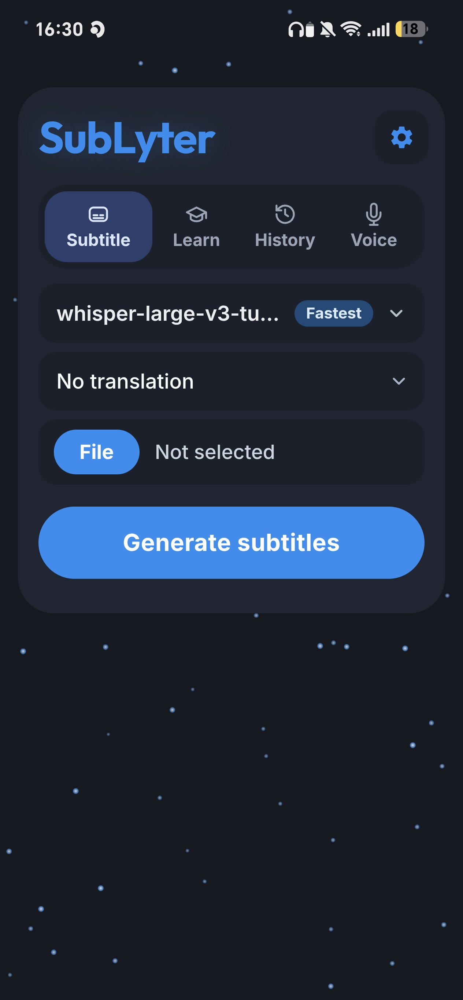
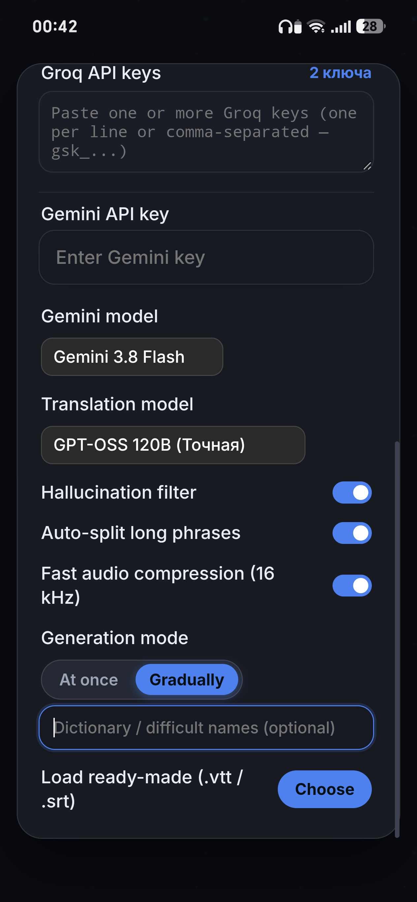
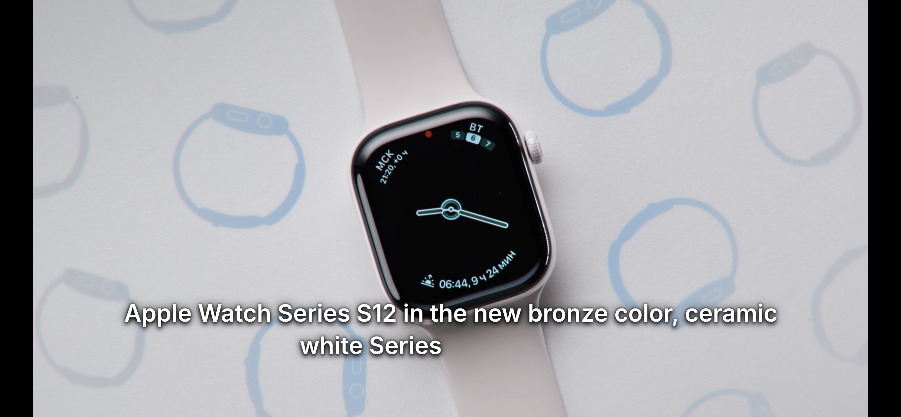
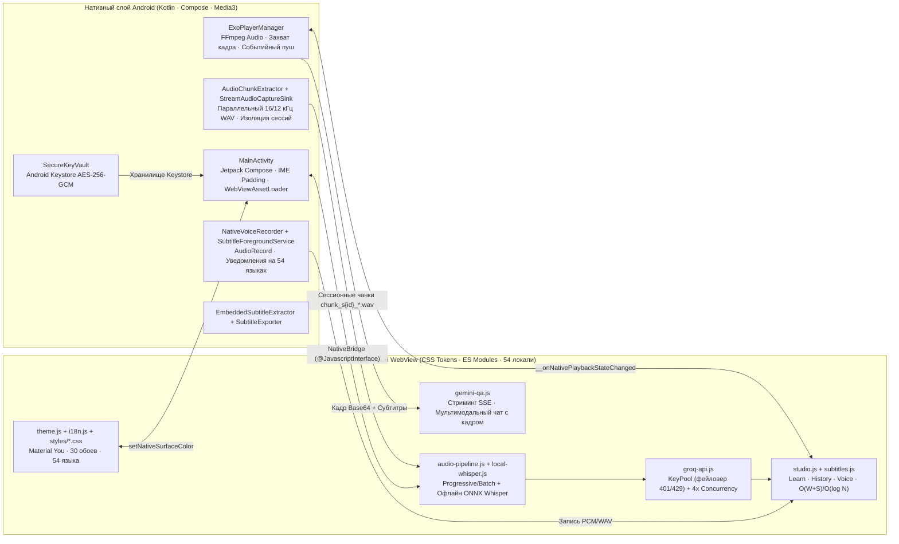

<div align="center">

<p>
  <a href="README.md">English</a> · <strong>Русский</strong>
</p>


<h1>SubLyter</h1>

<p>
  <strong>Единственная в своём роде Android-студия для субтитров, изучения языков, архива проектов и AI-голосовых заметок — объединяющая сверхбыстрый облачный AI на базе <a href="https://groq.com">Groq LPU™</a>, скачиваемые офлайн-модели Whisper ONNX, перевод на 53 языка, интерфейс на 54 языках и мультимодальный чат Gemini Video Q&amp;A в безрамочном Material You (Material 3) дизайне.</strong>
</p>

<p>
  <a href="https://github.com/yusibov2026-hue/SubLyter/releases/latest">
    
  </a>
  
  
  
  
  
  
</p>

<p>
  <a href="https://github.com/yusibov2026-hue/SubLyter/releases/latest"><strong>⬇️ Скачать последний APK</strong></a> •
  <a href="#-почему-sublyter--единственный-в-своём-роде"><strong>🌟 Уникальные фишки</strong></a> •
  <a href="#-скриншоты"><strong>📸 Скриншоты</strong></a> •
  <a href="#-почему-генерация-настолько-быстрая"><strong>⚡ Скорость генерации</strong></a> •
  <a href="#-настоящий-material-you-m3"><strong>🎨 Material You UI</strong></a> •
  <a href="#-архитектура-и-безопасность"><strong>🛡️ Архитектура</strong></a> •
  <a href="#-быстрый-старт-и-сборка"><strong>🛠️ Сборка и тесты</strong></a>
</p>

</div>

---

## 🌟 Почему SubLyter — единственный в своём роде

На Android **нет другого такого приложения, как SubLyter (`com.fromsub.app`)**. Обычные плееры либо просто ищут готовые `.srt`-файлы в сети, либо прячут базовое распознавание за дорогой ежемесячной подпиской. SubLyter объединяет в одном лёгком приложении **полноценную нативную медиастудию, языковой тренажёр, AI-архив и умный диктофон** — с аппаратным шифрованием ключей и максимальной скоростью:

1. **Облачная гиперскорость (`Groq LPU™`) + Полный офлайн (`ONNX Whisper`)** — Работайте через облако на аппаратных ускорителях **Groq LPU™** (`whisper-large-v3-turbo` / `whisper-large-v3`) за считанные секунды *или* скачайте прямо в приложении локальные модели **Whisper Base (~76 МБ)** и **Whisper Small (~245 МБ)** (`@huggingface/transformers`), чтобы распознавать речь полностью **без интернета**.
2. **Единая 4-вкладочная студия Material You** — Плавное переключение свайпами и общей осью (Shared-Axis) между четырьмя инструментами:
   - **🎬 Subtitle (Субтитры):** Мгновенные пословные субтитры для локальных видео (`MP4`, `MKV`) и сетевых потоков (`HLS .m3u8`, `DASH .mpd`, внешние ссылки из Stremio/Nuvio) с переводом на **53 языка**.
   - **🎓 Learn (Языковая студия):** Превращает *любое* видео в тренажёр иностранного языка — **двойные субтитры** на выбранном втором языке, **AI-разбор любого слова по тапу прямо в контексте сцены** и **карточки интервального повторения** (`IndexedDB`).
   - **🕘 History (История субтитров):** Автоматический архив всех сгенерированных проектов с живым поиском, фильтрами по языкам, экспортом `.SRT` и мгновенным возвратом обратно в плеер в один тап.
   - **🎙️ Voice (AI-диктофон и заметки):** Нативная запись с микрофона (`AudioRecord`) + импорт любых аудио и голосовых сообщений (`.ogg`, `.opus`, `.m4a`, `.mp3`, `.wav` из Telegram/WhatsApp) с автоматическим **Whisper Large v3 Turbo**, опциональным переводом, кратким AI-резюме и списком задач.
3. **Стриминговый мультимодальный чат Gemini Video Q&amp;A (`Gemini 4 Hydrogen`)** — Чат по видео в стиле YouTube в реальном времени: AI видит **полный текст субтитров с тайм-кодами и актуальный кадр видео** (даже на потоках `HTTP/HTTPS`), отвечая с кликабельными метками **`[MM:SS]`** для мгновенной перемотки.
4. **Безрамочный адаптивный плеер + живое меню субтитров (`#subMenu`)** — Media3 ExoPlayer с программным FFmpeg-аудиодекодером, автоматической геометрией под `9:16`, `1:1`, `16:9` и `21:9` без чёрных полос, режимами **Word-by-word / Karaoke / Full line**, выбором второго языка прямо во время просмотра и усилением громкости до **200%**.
5. **54 языка интерфейса + RTL из коробки** — Автоопределение системного языка телефона (включая корректную зеркальную вёрстку RTL для арабского, иврита, персидского и урду) и полная локализация статус-бара и системных уведомлений Android.

---

## 📸 Скриншоты

<div align="center">
<table>
  <tr>
    <td align="center" width="50%">
      <br />
      <sub><strong>Главный экран и обои «Снегопад»</strong><br/>Безрамочная карточка Material You, выбор модели Whisper, перевод на 53 языка и запуск в одно касание</sub>
    </td>
    <td align="center" width="50%">
      <br />
      <sub><strong>Глубокая кастомизация Material You (M3)</strong><br/>Режимы Dark/Light/Auto, палитра из 12 акцентов, 4 фоновых темы, 30 живых GPU-обоев и прозрачность</sub>
    </td>
  </tr>
  <tr>
    <td align="center" width="50%">
      <br />
      <sub><strong>Типографика и пул ключей Groq + Gemini</strong><br/>24 офлайн-шрифта с превью, мультиключевое хранилище Groq с бейджем и кнопками <code>Get API</code></sub>
    </td>
    <td align="center" width="50%">
      <br />
      <sub><strong>AI-модели, движок генерации и диагностика</strong><br/>Gemini 4 Hydrogen, GPT-OSS 120B, Qwen 3.6 27B, 54 языка интерфейса, режимы Progressive/All at once и <code>Copy log</code></sub>
    </td>
  </tr>
  <tr>
    <td align="center" colspan="2">
      <br />
      <sub><strong>Безрамочный полноэкранный плеер (горизонтальный режим)</strong><br/>Чёткие пословные и двойные субтитры поверх видео без чёрных полос</sub>
    </td>
  </tr>
</table>
</div>

---

## ⚡ Почему генерация настолько быстрая

> **На базе Groq LPU™ + параллельный нативный движок Media3:** Обычные сервисы загружают в облако тяжёлые видеофайлы и стоят в очередях GPU. SubLyter локально вырезает лёгкий моно PCM16 WAV в **4 параллельных потоках `MediaCodec`** и отправляет его через пул нескольких ключей **Groq LPU™** — выдавая пословные тайм-коды и перевод почти мгновенно.

| Слой оптимизации | Как это работает под капотом |
| :--- | :--- |
| **Молниеносный инференс Groq LPU™** | Распознавание речи (`whisper-large-v3-turbo` / `whisper-large-v3`) и перевод LLM (`openai/gpt-oss-120b`, `openai/gpt-oss-20b`, `qwen/qwen3.6-27b`) выполняются на **аппаратных процессорах Groq LPU™** с минимальной задержкой. |
| **Офлайн Whisper ONNX (`Base` и `Small`)** | В выборе модели (`#modelPickerSheet`) можно скачать квантованные ONNX-модели через `@huggingface/transformers`, декодировать WAV через `decodeWavToFloat32` и работать 100% автономно без интернета. |
| **Два режима: `Progressive` и `All at once`** | В **Progressive** субтитры распознаются и переводятся по чанкам (`16 кГц`) прямо во время воспроизведения. В **All at once** используется скоростной классический конвейер (`12 кГц` моно WAV, окна по 300 с с перекрытием 6 с, 4 параллельных потока без промежуточных задержек). |
| **Захват потоков быстрее реального времени** | Для сетевых потоков (`HLS .m3u8`, `DASH .mpd`, HTTP/HTTPS) кастомный Media3 `AudioSink` (`StreamAudioCaptureSink.kt`) декодирует аудио на **максимальной скорости CPU**, а не 1×. |
| **Пул ключей `KeyPool` + 4 воркера** | Можно добавить любое количество ключей Groq (`gsk_...`). `runWithConcurrency(..., 4)` распределяет запросы round-robin, мгновенно переключает ключ при HTTP `429` и отсеивает невалидные при HTTP `401`. |
| **Мгновенный поиск встроенных дорожек** | `EmbeddedSubtitleExtractor.kt` проверяет контейнеры MKV/MP4 на наличие готовых SRT/VTT/ASS субтитров ещё до обращения к AI. |
| **Zero-Copy HTTP-сервер чанков** | Готовые WAV-файлы отдаются прямо из кеша через перехват `WebResourceRequest` в WebView (`HTTP 200`/`206`) без медленной пересылки Base64 через JS-мост. |
| **Алгоритмы O(W + S) и O(log N)** | Линейное выравнивание слов по сегментам и бинарный поиск активной реплики держат **60–144 Гц** даже на многочасовых фильмах. |

---

## 🎨 Настоящий Material You (M3)

В SubLyter реализован полноценный, живой **Material You (Material 3)** дизайн — от CSS-токенов до нативной оболочки Jetpack Compose:

- **Полностью безрамочный интерфейс и обновлённое приветствие M3** — Чистый безрамочный главный блок (`#appTopSection`), объёмный приветственный диалог Material You (`#m3WelcomeModal`) с матовым фоном и тональными карточками, центрированные SVG-крестики и аккуратные нижние панели (`#modelPickerSheet`, `#subMenu`).
- **Сквозная тема `Dark` · `Light` · `Auto`** — Синхронизируется с системной темой Android, автоматически обновляя токены (`styles/tokens.css`), корневой цвет Jetpack Compose (`hostSurfaceColorState`) и контраст иконок статус-бара (`WindowInsetsController`).
- **12 тональных акцентов + свой HEX** — Готовые пресеты (включая чистый белый `#ffffff`) и произвольный подбор цвета с автоматическим расчётом контрастного текста поверх акцента (`--on-accent` и `--on-accent-chevron`).
- **4 оттенка поверхностей** — **Dark Gray**, **Gray**, **Light Slate** и **Warm Gray**.
- **30 GPU-ускоренных живых обоев** — **Snowfall**, **Aurora (Glow)**, **Cosmic Nebula**, **Neon Mesh**, **Plasma**, **Sunset**, **Ocean**, **Sound Waves**, **Neon Hexagons**, **Bokeh**, **Cyber Grid**, **Digital Matrix**, **Dot Matrix**, **Concentric Ripples**, **Stardust**, **Tech Circuit**, **Geometric Prisms**, **Checkerboard**, **Light Beams**, **Diagonal Stripes**, **Gray Tiles (Blur)**, **Galaxy**, **Lava**, **Rain**, **Silk Waves**, **Triangles**, **Night Skyline**, **Confetti**, **Vortex**, **Fireflies**, а также **No Wallpaper (Solid)** — подстраиваются под цвет акцента и ставятся на паузу в модальных окнах и Fullscreen.
- **24 офлайн-шрифта заголовка** — Встроенные `.woff2` шрифты (`Outfit`, `Plus Jakarta Sans`, `DM Sans`, `Syne`, `Space Grotesk`, `Unbounded` и др.) с регулировкой размера (`18–38px`).

---

## 🎬 Адаптивный плеер, Gemini Q&amp;A и студия

### Безрамочный видеоплеер
- **Media3 ExoPlayer + программный FFmpeg-декодер аудио** — Проигрывает MKV, AC3/EAC3/DTS/FLAC, HLS `.m3u8` и DASH `.mpd`, даже если стандартный `<video>` не поддерживает кодек.
- **Адаптация под любые пропорции без полос** — `syncPlayerAspectRatio` учитывает `pixelWidthHeightRatio` и угол поворота `unappliedRotationDegrees` для `9:16`, `1:1`, `16:9` и `21:9`.
- **Двойные субтитры и тап по слову (`#subMenu` + Learn)** — Мгновенно переключайте режим двойных субтитров и выбирайте второй язык прямо в плеере (`translateSegments`), а тап по любому слову открывает AI-разбор значения в контексте с сохранением карточки в словарь.
- **3 режима показа слов и полный контроль** — **Word-by-word**, **Karaoke**, **Full line**, слайдеры **Offset** / **Hold**, **Fit / Fill / Stretch**, скорость, двойной тап перемотки, выбор аудиодорожек, **200% усиление громкости**, нормализация тихого WAV и фильтр галлюцинаций Whisper.
- **Экспорт в 4 формата + История** — Выгрузка и «Поделиться» в **`.VTT`**, **`.SRT`**, **`.ASS` (`\kf`)** и **`.TXT`**; импорт готовых субтитров; автосохранение всех проектов во вкладке **History**.

### Мультимодальный AI-чат Gemini Video Q&amp;A
- Стриминг ответов в реальном времени через **Gemini 4 Hydrogen** (с настройкой минимального thinking и умным откатом при HTTP 400), **Gemini 3.8 Flash**, **Gemini 2.5 Flash**, **Gemini 2.5 Pro** и **Gemini 2.0 Flash**.
- Автоматически прикрепляет **актуальный кадр видео** (`getCurrentFrameBase64` для локальных и `http`/`https` видео) при вопросах о происходящем на экране и формирует кликабельные тайм-коды **`[MM:SS]`**.

### AI-диктофон и заметки (`#hubPanelVoice`)
- Встроенная нативная запись через `AudioRecord` (`NativeVoiceRecorder.kt`) плюс кнопка выбора аудиофайла (`.ogg`, `.opus`, `.m4a`, `.mp3`, `.wav`).
- Автоматически использует **`whisper-large-v3-turbo`**, поддерживает акцентный выбор языка перевода (`#voiceTranslateLang`), формирует расшифровку, краткое резюме и чеклист задач с мгновенным поиском.

---

## 🛡️ Архитектура и безопасность

### Схема Native + WebView студии



### Инженерная надёжность
- **Аппаратное шифрование ключей** — Ключи Groq и Gemini хранятся в `EncryptedSharedPreferences` (`AES256_GCM` / `MasterKey`) и прогреваются в фоне без фриза UI.
- **Zero `file://` утечек** — Ресурсы подаются через `WebViewAssetLoader` по виртуальному HTTPS-источнику; `allowFileAccessFromFileURLs`, `allowUniversalAccessFromFileURLs` и смешанный контент отключены.
- **Изоляция сессий и защита путей** — Аудиочанки имеют имена `chunk_s{sessionId}_*.wav` и проверяются на Path Traversal (`ChunkCachePaths.resolveSafeChunkFile`).
- **Продакшн-конфигурация** — `android:allowBackup="false"`, `network_security_config.xml`, foreground-сервис с `START_NOT_STICKY`, R8-минификация для релизных сборок, ноль предупреждений компилятора Kotlin и диагностика (**Settings → Copy log**) с авто-маскировкой ключей (`gsk_***`, `AIza***`, `Bearer ***`).

### Структура проекта

```text
app/src/main/
├── java/com/fromsub/app/
│   ├── MainActivity.kt               # Compose-хост, отступы клавиатуры/баров, WebViewAssetLoader
│   ├── NativeBridge.kt               # Типизированный мост @JavascriptInterface
│   ├── ExoPlayerManager.kt           # ExoPlayer, FFmpeg-аудио, пуш состояния, захват кадра
│   ├── AudioChunkExtractor.kt        # Параллельный MediaCodec WAV-декодер и HTTP-сервер чанков
│   ├── StreamAudioCaptureSink.kt     # Non-real-time AudioSink для захвата потоков без ожидания
│   ├── WavChunkWriter.kt             # Даунмикс PCM16, ресемплинг и RIFF WAV-заголовок
│   ├── NativeVoiceRecorder.kt        # Нативный диктофон Android на AudioRecord
│   ├── EmbeddedSubtitleExtractor.kt  # Извлечение встроенных дорожек из MKV/MP4
│   ├── SubtitleExporter.kt           # Сохранение в MediaStore Downloads и «Поделиться»
│   ├── SecureKeyVault.kt             # Шифрованное хранилище API-ключей Keystore
│   └── SubtitleForegroundService.kt  # Локализованное foreground-уведомление и отмена
└── assets/
    ├── index.html                    # Каркас студии и обновлённое приветственное окно M3
    ├── i18n/                         # 54 полные локализации JSON (включая RTL-языки)
    ├── fonts/                        # 24 встроенных шрифта .woff2
    ├── styles/                       # fonts · tokens · wallpapers · player · settings · studio
    └── js/                           # diagnostics · bridge · storage · i18n · subtitles ·
                                      # groq-api · gemini-qa · local-whisper · theme ·
                                      # player · studio · audio-pipeline · app
tests/                                # 7 наборов · 32 автотеста
├── diagnostics.test.mjs              # Маскировка ключей и кольцевой буфер логов
├── gemini-qa.test.mjs                # XSS-санитизация, захват кадра и тайм-коды
├── groq-api.test.mjs                 # Ротация KeyPool, фейловер 401/429 и нормализация WAV
├── i18n.test.mjs                     # Проверка всех 54 языков, RTL и плейсхолдеров
├── local-whisper.test.mjs            # Реестр ONNX-моделей, WAV-декодер и сегменты
├── studio.test.mjs                   # Двойные субтитры, карточки, история и голосовые заметки
└── subtitles.test.mjs                # VTT/SRT/ASS/TXT, O(W+S) выравнивание и защита нахлёстов
```

---

## 🚀 Быстрый старт и сборка

### 1. Установка на Android
1. Скачайте актуальный APK со страницы **[GitHub Releases](https://github.com/yusibov2026-hue/SubLyter/releases/latest)**.
2. Откройте **Настройки** (шестерёнка) и добавьте один или несколько **Groq API-ключей** с [console.groq.com/keys](https://console.groq.com/keys) — либо выберите **Офлайн Whisper (`Base` / `Small`)** в списке моделей для работы без ключа и интернета.
3. *(Опционально)* Вставьте **Gemini API-ключ** с [aistudio.google.com/apikey](https://aistudio.google.com/apikey) для стримингового чата по видео и кадрам (`Gemini 4 Hydrogen`).
4. Выберите видео, откройте поток через **SubLyter** или переключитесь на вкладки **Учёба / История / Голос**.

### 2. Запуск автотестов (Node 18+)
```bash
node --test --test-concurrency=1 tests/*.test.mjs
```

### 3. Сборка из исходников
```bash
# Требования: JDK 17, Android SDK (compileSdk 34, minSdk 24)
./gradlew assembleDebug

# Релизная сборка с R8
./gradlew assembleRelease
```

---

## 📄 Примечания
- Разработано для Android 7.0+ (`minSdk = 24`, `targetSdk = 34`, `package = com.fromsub.app`).
- Для диагностики любого сценария откройте **Настройки → Копировать лог** (`Copy log`), чтобы скопировать очищенный от ключей журнал событий.
